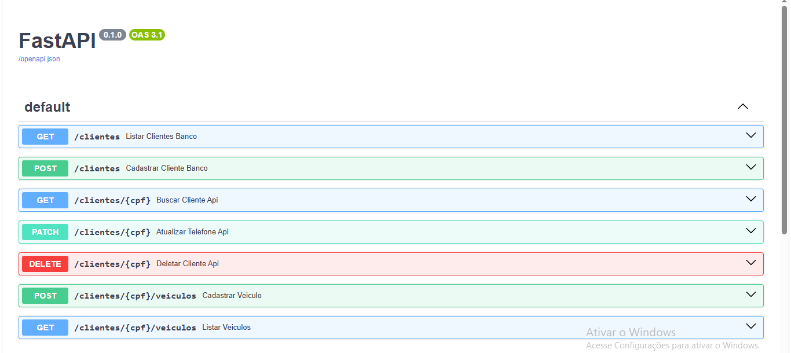

# 🚗 IPVA Control

Sistema para controlar o **IPVA parcelado** de clientes e avisar quais boletos estão perto de vencer.

Comecei esse projeto para estudar back-end com Python, mas a ideia nasceu de um problema real: em despachantes, acompanhar dezenas de parcelas e vencimentos na mão (ou em planilha) dá muito trabalho e é fácil esquecer alguém. Quis ver como isso ficaria como sistema de verdade.

> ⚠️ **Projeto de estudo com dados fictícios.** Nenhum dado real de cliente ou de veículo é usado aqui.

## 🚧 Status

Ainda estou construindo, então o projeto cresce a cada commit.

- [x] Conexão com o banco de dados (Supabase)
- [x] Cadastrar, listar e buscar clientes
- [x] Atualizar o telefone e deletar cliente
- [x] Cadastrar e listar veículos de um cliente
- [x] Tratamento de erros (404 e 409 para CPF e veículo duplicados)
- [ ] Parcelas do IPVA com data de vencimento
- [ ] Painel com os boletos que estão para vencer
- [ ] Login de usuários

## 🔌 Rotas da API

| Método | Rota | O que faz |
|---|---|---|
| POST | `/clientes` | Cadastra um cliente |
| GET | `/clientes` | Lista os clientes |
| GET | `/clientes/{cpf}` | Busca um cliente pelo CPF |
| PATCH | `/clientes/{cpf}` | Atualiza o telefone do cliente |
| DELETE | `/clientes/{cpf}` | Remove o cliente e os veículos dele |
| POST | `/clientes/{cpf}/veiculos` | Cadastra um veículo para o cliente |
| GET | `/clientes/{cpf}/veiculos` | Lista os veículos do cliente |



A documentação interativa (Swagger) fica em `/docs` quando a API está rodando.

## 🗄️ Banco de dados

Duas tabelas no Supabase (PostgreSQL):

- **clientes**: `id`, `nome`, `cpf` (único), `telefone`
- **veiculos**: `id`, `placa`, `renavam`, `chassi` (os três únicos) e `cliente_id`, que aponta para o cliente. Se o cliente é apagado, os veículos dele vão junto (`ON DELETE CASCADE`).

## 🛠️ Tecnologias

- Python 3.13
- FastAPI
- Supabase (PostgreSQL)
- Pydantic

## ▶️ Como rodar

1. Clone o repositório e entre na pasta:
   ```
   git clone https://github.com/menezesxx/ipva-control.git
   cd ipva-control
   ```
2. Crie e ative o ambiente virtual:
   ```
   python -m venv .venv
   .venv\Scripts\activate
   ```
3. Instale as dependências:
   ```
   pip install -r requirements.txt
   ```
4. Crie um arquivo `.env` na raiz do projeto com as chaves do seu projeto no Supabase:
   ```
   SUPABASE_URL=
   SUPABASE_PUBLISHABLE_KEY=
   ```
5. Crie as tabelas `clientes` e `veiculos` no Supabase, como descrito acima.
6. Rode a API:
   ```
   uvicorn main:app --reload
   ```
7. Abra `http://127.0.0.1:8000/docs` para ver e testar as rotas.

## 🔒 Sobre segurança

Por ser um projeto de estudo com dados fictícios, as policies de RLS do Supabase estão abertas para a chave pública. Num sistema real isso não pode ser assim: o próximo passo é ter login de usuários e policies que dependam de quem está logado.

## 🤖 Uso de IA

Estou fazendo este projeto com o auxílio de IA generativa (**ChatGPT** e **Claude**). O uso dessas ferramentas é como um mentor: para tirar dúvidas, entender erros, revisar o que escrevi e decidir os próximos passos. Eu escrevo o código, testo e faço os commits, e tento entender cada parte antes de seguir.

## 🔭 Próximos passos

- Parcelas do IPVA (valor, vencimento e se já foi paga)
- Painel dos boletos que vencem nos próximos dias
- Login e policies mais restritas
- Padronizar o CPF (só números) com validação
- Testes automatizados

## 👤 Autor

Feito por **Kauan Menezes**, estudante de Sistemas de Informação no CEFET-MG.
[GitHub](https://github.com/menezesxx) · [LinkedIn](https://www.linkedin.com/in/kauanmenezesbecatti/)